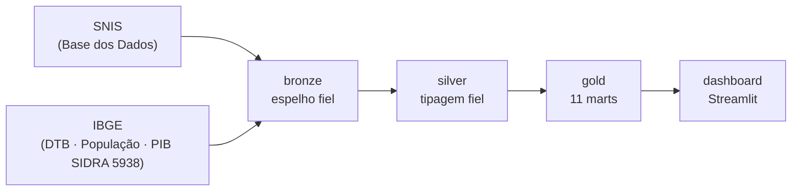
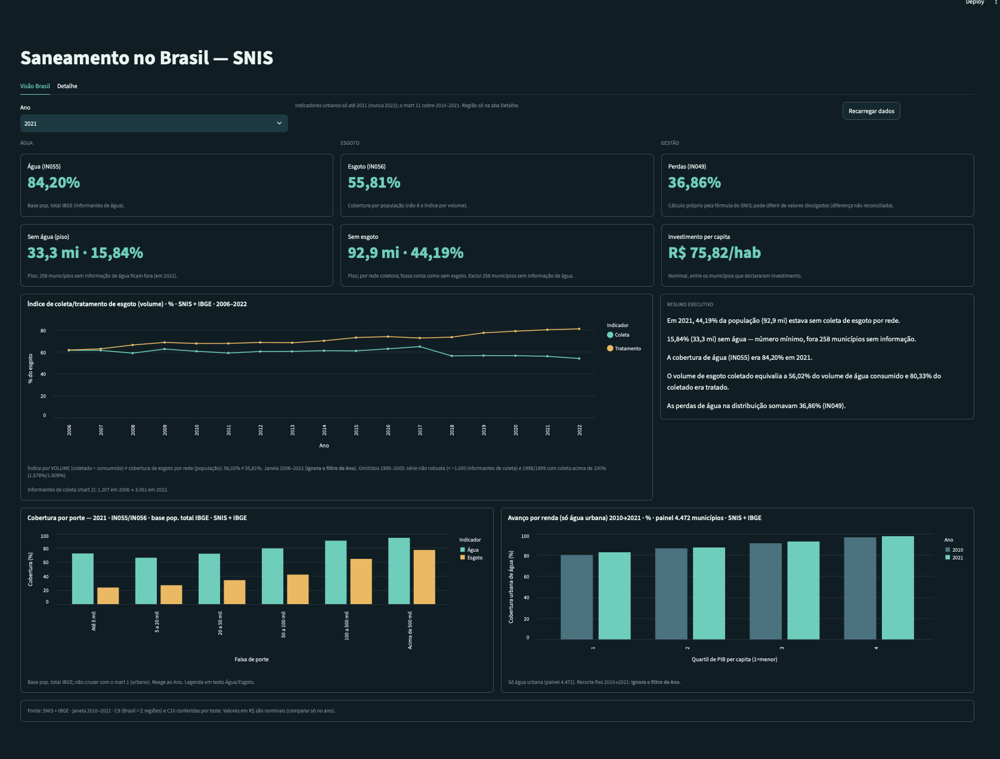
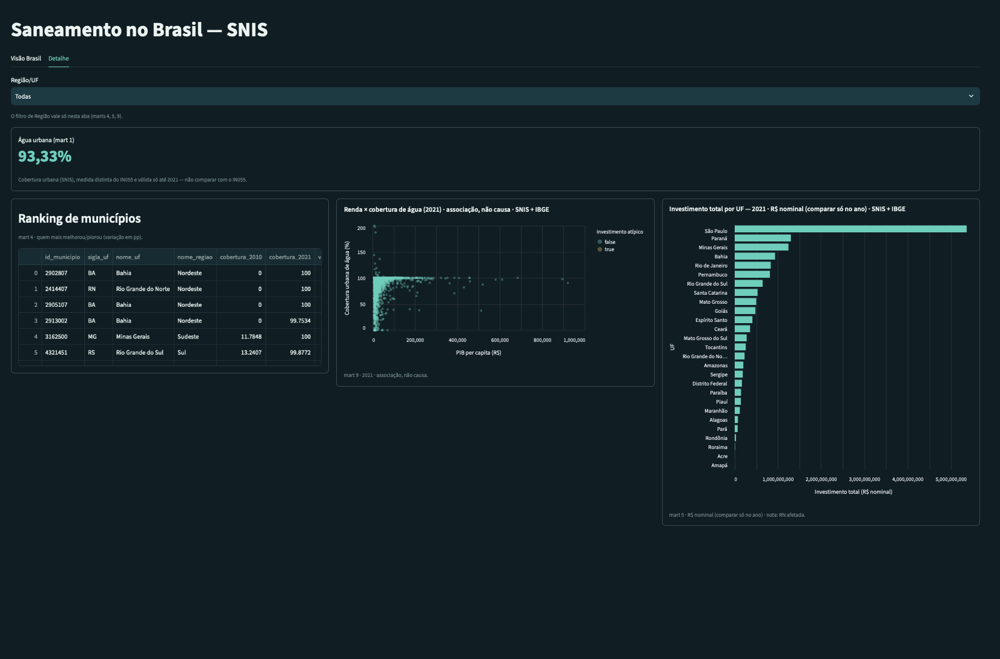

# SNIS — Pipeline medalhão

**Problema.** O acesso a água e esgoto no Brasil é desigual entre regiões, portes
de município e faixas de renda. **Pergunta de negócio:** *qual a cobertura de água
e de esgoto no Brasil, quantos habitantes seguem sem serviço e onde o atendimento
mais avançou (ou ficou para trás) entre 2010 e 2021?*

Pipeline de dados com arquitetura medalhão sobre o **SNIS** (Sistema Nacional de
Informações sobre Saneamento), tabela `municipio_agua_esgoto`, cobrindo **1995 a
2022** (119.256 registros, 133 variáveis, 5.549 municípios), cruzado com o
**IBGE** (território, população e PIB).

## Camadas



| Camada | Status | Descrição |
|---|---|---|
| **bronze** | ✅ | Espelho fiel do CSV — tudo como texto, sem transformações. |
| **silver** | ✅ | Tipagem fiel da bronze e correção de um erro de digitação de coluna. |
| **gold** | ✅ | **11 marts** (10 analíticos + `kpis_brasil` de apoio) para análise. |
| **dashboard** | ✅ | Painel em Streamlit sobre a gold, somente leitura. |

## Dashboard





Painel em **Streamlit** sobre a camada gold (spec em
[`docs/spec-dashboard.md`](docs/spec-dashboard.md)). Lê **somente o schema `gold`**,
em conexão **somente leitura**, e **não calcula nada na tela** (toda agregação vem
da gold; os KPIs nacionais vêm do mart de apoio **`gold.kpis_brasil`**, D34).

**Páginas (abas):**

- **Visão Brasil** — página única em faixas, filtro só de **Ano** (2010–2021,
  nunca 2022) no cabeçalho + botão **Recarregar dados**:
  - **Faixa A — KPIs em 3 colunas temáticas** (`gold.kpis_brasil`):
    **Água** (IN055 / "sem água", piso), **Esgoto** (IN056 / "sem esgoto", por rede
    coletora), **Gestão** (perdas IN049 / investimento per capita, nominal).
  - **Faixa B** — **índice de coleta/tratamento** de esgoto por volume
    (`gold.esgoto_coleta_tratamento_ano`, série 1995–2022, ignora o Ano) +
    **resumo executivo** por frases-modelo (`gold.kpis_brasil`).
  - **Faixa C** — **cobertura por porte** (`gold.atendimento_porte_ano`, reage ao
    Ano) + **avanço por renda** (`gold.avanco_por_renda_painel`, fixo 2010→2021).
  - **Faixa D** — rodapé: fontes, janela, C9/C10, R$ nominal.
- **Detalhe** — ganha o filtro de **Região/UF**: **Água urbana**
  (`gold.kpis_brasil`/mart 1), **ranking** de municípios
  (`gold.ranking_atendimento_variacao`), **renda × PIB**
  (`gold.atendimento_vs_pib_2021`) e **financeiro por UF** (`gold.financeiro_uf_ano`).

Tema escuro verde-azulado em [`.streamlit/config.toml`](.streamlit/config.toml),
espelhando a paleta de [`tema.py`](tema.py) (contraste WCAG verificado). Figuras e
consultas em [`painel.py`](painel.py); formatação de R$/%/número em
[`formato.py`](formato.py) (sem `locale`). Testes: [`tests/test_dashboard.py`](tests/test_dashboard.py),
[`tests/test_app.py`](tests/test_app.py) (via `streamlit.testing.v1.AppTest`),
[`tests/test_tema.py`](tests/test_tema.py).

## Como rodar

> ⚠️ **Um clone não traz os dados nem o banco:** `data/raw/` e `snis.duckdb`
> **não são versionados**. Num clone limpo, **os testes que dependem do banco
> falham** até você colocar as fontes em `data/raw/` e rodar `executar.py` (ver
> **Como reproduzir do zero**).

Pré-requisito: os arquivos de origem em `data/raw/` (ver **Como reproduzir do
zero**). Depois, em 3 comandos:

```bash
uv sync                        # instala dependências
uv run python executar.py      # apaga o banco e reconstrói as 6 etapas do zero
uv run streamlit run app.py    # abre o dashboard em http://localhost:8501
```

Testes e linter: `uv run pytest -v` · `uv run ruff check .`

## Documentos que importam

**Contrato** (specs e decisões — o que o código deve respeitar):

- [`docs/spec-ingestao.md`](docs/spec-ingestao.md) — bronze SNIS.
- [`docs/spec-transformacao.md`](docs/spec-transformacao.md) — silver SNIS.
- [`docs/spec-ibge.md`](docs/spec-ibge.md) — ingestão/silver do IBGE.
- [`docs/spec-gold.md`](docs/spec-gold.md) — gold (11 marts) e limitações §8.
- [`docs/spec-dashboard.md`](docs/spec-dashboard.md) — dashboard.
- [`docs/decisoes.md`](docs/decisoes.md) — decisões aprovadas (D1–D40).
- [`docs/fontes-ibge.md`](docs/fontes-ibge.md) — catálogo das fontes IBGE.
- [`docs/indicadores.md`](docs/indicadores.md) — fórmulas e grão dos marts.

**Histórico** (investigação e conferência):

- [`docs/investigacao-silver.md`](docs/investigacao-silver.md) — base dos números da silver.
- [`docs/contagens.md`](docs/contagens.md) — contagens de todas as tabelas e tempo de reconstrução.

Guia de leitura completo em [`docs/README.md`](docs/README.md).

## A camada silver

A silver faz **uma coisa só**: tipa fielmente a bronze, sem semântica de
negócio. 119.256 linhas entram e 119.256 saem; 133 colunas, na mesma ordem da
bronze.

- **Tipos:** 26 `INTEGER`, 2 `VARCHAR` (`id_municipio`, `sigla_uf`),
  105 `DECIMAL(18,2)`.
- **Único rename:** `populacao_atentida_esgoto` → `populacao_atendida_esgoto`
  (corrige erro de digitação da fonte).
- **Regras bloqueantes** (`ROLLBACK` + saída com erro): valor que não converte,
  fora de faixa, `DECIMAL` com mais de 2 casas, `ano` fora de `AAAA`,
  `id_municipio` fora de 7 dígitos, chave `(ano, id_municipio)` nula/repetida,
  contagem de linhas ou colunas diferente da bronze, célula vazia ou só espaços.
- **Alertas** (preserva o dado, só conta e reporta): 43 colunas com negativos,
  47.934 linhas com `populacao_atendida_agua > populacao_urbana`, 23 colunas
  `indice_*` acima de 100, `populacao_urbana_atendida_esgoto` 100% nula em 2022.

Anomalias **não são corrigidas** na silver — isso é responsabilidade da gold.

## A camada gold — os 11 marts

Cada mart é um `SELECT` em `sql/gold/NN_nome.sql`; o executor
([`pipeline/gold.py`](pipeline/gold.py)) compõe o `CREATE TABLE` e recria o schema
`gold` do zero. Grão, fórmulas e decisões estão em
[`docs/spec-gold.md`](docs/spec-gold.md) e [`docs/indicadores.md`](docs/indicadores.md).

| # | Tabela (`gold.`) | Pergunta de negócio |
|---|---|---|
| 1 | `atendimento_uf_ano` | Qual % da população **urbana** tem água e esgoto, por UF e ano? |
| 2 | `esgoto_coleta_tratamento_ano` | Quanto do esgoto é **coletado e tratado** no Brasil, ano a ano? |
| 3 | `perdas_consumo_uf_ano` | Quanta água se **perde** na distribuição e quanto se **consome** por pessoa, por UF e ano? |
| 4 | `ranking_atendimento_variacao` | Quais municípios mais **melhoraram/pioraram** no atendimento urbano de água entre 2010 e 2021? |
| 5 | `financeiro_uf_ano` | Quanto se **investe e gasta** por UF e ano (tarifa, despesa unitária), em R$ nominais? |
| 6 | `atendimento_porte_ano` | Como variam as coberturas de água e esgoto por **faixa de porte** do município? |
| 7 | `populacao_sem_servico_uf_ano` | Quantos habitantes, em **números absolutos**, estão sem água e sem coleta de esgoto, por UF? |
| 8 | `investimento_per_capita_uf_ano` | Quanto se **investe por habitante**, por UF e ano, em R$ nominais? |
| 9 | `atendimento_vs_pib_2021` | Como cobertura, perdas e investimento se relacionam com o **PIB per capita** do município em 2021? |
| 10 | `avanco_por_renda_painel` | O atendimento urbano de água **avançou mais** entre 2010 e 2021 em municípios de maior ou menor **renda**? |
| 11 | `kpis_brasil` | KPIs e frases-resumo nacionais de apoio ao dashboard (água, esgoto, gestão). |

Contagens de todas as tabelas (bronze, silver, gold) e tempo de reconstrução em
[`docs/contagens.md`](docs/contagens.md).

## Como reproduzir do zero

Os dados **não ficam no repositório** (`data/raw/` está no `.gitignore`). Baixe as
quatro origens, coloque cada uma na pasta esperada e rode o pipeline. A extração de
referência é **2026-11-08** (o pipeline procura as fontes IBGE em
`data/raw/ibge/<fonte>/2026-11-08/`, data fixada em
[`pipeline/ibge.py`](pipeline/ibge.py)).

### 1. SNIS — `municipio_agua_esgoto`

- **Fonte:** [Base dos Dados](https://basedosdados.org/) — tabela
  `br_mdr_snis.municipio_agua_esgoto`.
- **Destino:** `data/raw/br_mdr_snis_municipio_agua_esgoto.csv.gz`
  (**não descompacte**).

### 2. IBGE-POP — População residente municipal

- **Fonte:** Base dos Dados — `br_ibge_populacao.municipio` (export do console do
  BigQuery; consulta e checksums no `MANIFEST.md` da pasta de extração). *(Esse
  MANIFEST não é versionado; é gerado junto com a extração.)*
- **Destino:** `data/raw/ibge/populacao/2026-11-08/populacao_municipio.csv`
  (colunas `ano`, `id_municipio`, `populacao`; 191.099 linhas).

### 3. IBGE-PIB — PIB dos municípios (SIDRA 5938)

- **Fonte:** API pública do SIDRA, tabela **5938**, variável **37** ("PIB a preços
  correntes", Mil Reais), nível `n6`, anos 2010–2021:
  `https://apisidra.ibge.gov.br/values/t/5938/n6/all/v/37/p/<ANO>`.
- **Destino:** `data/raw/ibge/pib/2026-11-08/pib_municipio.csv`
  (colunas `id_municipio`, `nome_municipio`, `ano`, `variavel`, `unidade`,
  `valor`; 66.840 linhas). Detalhes de montagem em
  [`docs/fontes-ibge.md`](docs/fontes-ibge.md) (seção IBGE-PIB).

### 4. IBGE-DTB — Divisão Territorial Brasileira 2025

- **Fonte:** [`DTB_2025.zip`](https://geoftp.ibge.gov.br/organizacao_do_territorio/estrutura_territorial/divisao_territorial/2025/DTB_2025.zip)
  (servidor geoftp; a página oficial do produto retorna HTTP 403 em coleta
  automatizada). Arquivo usado: `RELATORIO_DTB_BRASIL_2025_MUNICIPIOS.xls`, aba
  `DTB_Municípios`, convertido para CSV.
- **Destino:** `data/raw/ibge/dtb/2026-11-08/dtb_municipio.csv` (5.571 linhas).

### 5. Rodar

```bash
uv sync
uv run python executar.py        # bronze→silver (SNIS) → bronze→silver (IBGE) → cobertura → gold
uv run streamlit run app.py      # dashboard
uv run pytest -v                 # testes (bronze, silver, IBGE, gold, dashboard)
```

`executar.py` roda as **6 etapas** em ordem: bronze SNIS → silver SNIS → bronze
IBGE → silver IBGE → cobertura SNIS×IBGE → gold (10 marts **+ `kpis_brasil`**).
Reconstrução completa em ~10 s (ver [`docs/contagens.md`](docs/contagens.md)).

> **A confirmar:** os nomes de arquivo e colunas acima vêm dos `MANIFEST.md` de
> cada pasta de extração em `data/raw/ibge/` (não versionados) e de
> [`docs/fontes-ibge.md`](docs/fontes-ibge.md). O passo de conversão `.xls` → `.csv`
> da DTB e o export do BigQuery da população são manuais e documentados nesses
> manifests; não há script versionado que os reproduza automaticamente.

## Fontes e licenças

Data de extração de todas as fontes: **2026-11-08**. A licença **MIT** deste
repositório cobre **o código, não os dados** — cada fonte tem seus próprios termos.
**Não afirmamos uma licença específica para os dados**: consulte os termos da fonte.

| Fonte | Usada para | Termos (verificado em 2026-11-09) |
|---|---|---|
| **SNIS** (Ministério das Cidades / MDR) | tabela base `municipio_agua_esgoto` | Página do SNIS em [gov.br/mdr](https://www.gov.br/mdr/pt-br/assuntos/saneamento/snis): conteúdo restrito/autenticação na coleta; não encontramos termos de reúso específicos para os microdados do SNIS. **Consulte os termos da fonte.** |
| **Base dos Dados** | distribuição do SNIS e da população IBGE | [basedosdados.org/terms](https://basedosdados.org/terms): os termos tratam da assinatura/serviço; sobre os dados dizem que *"todos os direitos de propriedade intelectual relacionados aos dados fornecidos são de propriedade de terceiros"* e estão *"sujeitos às suas respectivas políticas de uso"*. **Consulte os termos da fonte e da fonte original.** |
| **IBGE** (DTB, População, PIB/SIDRA) | território, denominador de cobertura, PIB | [Política de dados abertos do IBGE](https://www.ibge.gov.br/acesso-informacao/institucional/politica-de-dados-abertos.html): a página **retornou HTTP 403** na coleta automatizada, então **não citamos seu conteúdo**. **Consulte os termos da fonte.** |

Catálogo detalhado das fontes IBGE (IDs, URLs, chaves, limitações) em
[`docs/fontes-ibge.md`](docs/fontes-ibge.md).

## Stack

Python · [uv](https://docs.astral.sh/uv/) · DuckDB · Streamlit · Altair · pytest · ruff

## MCP (opcional)

Para explorar o banco via MCP, em modo **somente leitura**:

```bash
claude mcp add --scope project duckdb -- uvx mcp-server-motherduck --db-path snis.duckdb
```

## Estrutura de pastas

```
.
├── data/raw/                  # fonte (somente leitura, fora do repo)
├── docs/
│   ├── README.md                  # guia de leitura (contrato × histórico)
│   ├── contagens.md               # contagens da fonte e de todas as tabelas
│   ├── decisoes.md                # decisões aprovadas (D1–D40)
│   ├── indicadores.md             # fórmulas e grão dos marts
│   ├── fontes-ibge.md             # catálogo das fontes IBGE
│   ├── investigacao-silver.md     # base dos números da silver
│   ├── spec-ingestao.md           # spec da camada bronze
│   ├── spec-transformacao.md      # spec da camada silver
│   ├── spec-ibge.md               # spec da ingestão/silver do IBGE
│   ├── spec-gold.md               # spec da camada gold (11 marts)
│   └── spec-dashboard.md          # spec do dashboard
├── pipeline/
│   ├── db.py                  # caminhos e conexão com o banco
│   ├── conferir.py            # validação rápida do CSV
│   ├── ingestao.py            # bronze SNIS
│   ├── transformacao.py       # silver SNIS
│   ├── ingestao_ibge.py       # bronze IBGE
│   ├── transformacao_ibge.py  # silver IBGE
│   ├── ibge.py                # catálogo/paths das fontes IBGE
│   ├── cobertura.py           # cobertura de junção SNIS × IBGE
│   └── gold.py                # executor dos marts
├── sql/gold/                  # um SELECT por mart (NN_nome.sql)
├── tests/                     # bronze, silver, IBGE, gold, dashboard
├── app.py                     # entrada do dashboard Streamlit
├── painel.py · formato.py · tema.py   # consultas/figuras, formatação, paleta
├── executar.py                # orquestrador do pipeline (6 etapas)
└── pyproject.toml
```

## Licença

Código sob licença **MIT** (ver [`LICENSE`](LICENSE)). A licença cobre **o código,
não os dados**: cada fonte de dados tem seus próprios termos (ver **Fontes e
licenças**).

## Limitações conhecidas

Pendências que o **dashboard** precisa respeitar (inventário completo em
[`docs/spec-gold.md`](docs/spec-gold.md) §8 e [`docs/decisoes.md`](docs/decisoes.md)):

- **IN049 (perdas) 2021 não reconciliado:** o painel mede **36,86%** em 2021;
  divulgações oficiais encontradas citam **39,3%** e **40,3%** (ambas acima do
  nosso número), sem que se tenha confirmado qual é a correta — por isso o painel
  **não cita** número publicado.
- **Esgoto urbano "entre informantes"** (marts 1 e 9): a cobertura urbana de
  esgoto cobre só quem informa esgoto (≈72,5% em 2021), não o Brasil todo — viés
  de seleção; distinta do IN056 por porte/UF (55,8%). Rotular como tal. Ver
  [D32](docs/decisoes.md).
- **Indicadores urbanos só até 2021:** a população urbana autodeclarada é **100%
  nula em 2022**; os marts urbanos (1, 4, 9, 10) usam 2021 e nunca 2022. Ver
  [D2](docs/decisoes.md).
- **Alerta A2 (urbana atendida > urbana):** massivo **antes de 2010**, pequeno na
  janela (41 casos 2010–2021, excluídos com flag). Não plotar cobertura urbana
  antes de 2010. Ver [D5](docs/decisoes.md).
- **Semântica fina de investimento/receita** (prestador vs. município vs. estado;
  direta vs. indireta) nos marts 5 e 8 **a confirmar** no dicionário do SNIS; os
  valores são **nominais** (sem deflação) e mantidos como vêm da fonte — ressalva
  no painel. Ver [`docs/indicadores.md`](docs/indicadores.md).
- **Esgoto importado/exportado (mart 2):** a definição oficial de "volume
  disponibilizado" de esgoto está **a confirmar**; o índice pode passar de 100 por
  importação/exportação. Ver [D23](docs/decisoes.md).
- **Índice de coleta acima de 100% em 1998 e 1999 (mart 2):** o índice nacional de
  coleta é **1.578,4% (1998, 233 informantes)** e **1.609,2% (1999, 247
  informantes)** — os dois únicos anos com coleta > 100% (**fato, sem causa
  atribuída**). A gold mantém a série completa 1995–2022; o **dashboard** exibe só
  a janela robusta **≥ 2006**, omitindo 1995–2005. Ver [D40](docs/decisoes.md).
- **Faixas não implementadas (v2.1):** o alerta **A2** e o **2022 nulo** da silver
  ficam só documentados, sem tratamento novo.
- **Relatório HTML estático:** **fora do escopo** (D39).
- **Anomalia 1998/1999** acima: registrada como fato, sem correção.
- **Deploy:** o app precisa do `snis.duckdb`, que **não é versionado** e é
  reconstruído por `executar.py` a partir de `data/raw/`.

A **silver não converte unidade nenhuma** nem corrige anomalias — isso é papel da
gold (decisões D1–D40).
</content>
